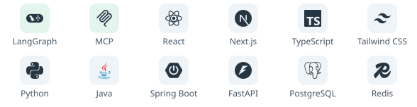

# 你好，我是维生素 👋

我喜欢把新技术跑起来，再追一层源码，弄懂它为什么能跑。平时用 React 写前端，用 Python 和 Java 做后端，最喜欢做 AI Agent。最近在琢磨 Agent 怎么把任务做稳，也在学大模型的推理和微调。

## 技术栈

<picture>
  <source media="(max-width: 520px)" srcset="assets/tech-stack-mobile.svg">
  
</picture>

展开完整技术栈

- **前端**　HTML · CSS · JavaScript · TypeScript · React · Next.js · Vite · Tailwind CSS · Ant Design · ECharts · React Router · Zustand
- **后端**　Java · Spring Boot · Spring Cloud · Python · FastAPI · Pydantic · REST API · asyncio · SSE · APScheduler
- **数据与部署**　MySQL · PostgreSQL · Redis · RocketMQ · Docker · Nginx
- **AI 应用**　Agent 工作流与运行时 · LangGraph · LangChain4j · 工具调用 · MCP · 上下文管理 · RAG · Milvus · pgvector · BM25 · RRF · 重排序 · RAGAS
- **测试与联调**　Playwright · Postman

## 项目时间轴

> **● InvestMate · 个人投资助手**　`2026.05 至今`
>
> 独立开发自选股提醒、行情查证和持仓复盘，通过 MCP 接入金融数据，让回答里的数字能追溯到来源和时点。
>
> **● 全链路智能信贷助手**　`2026.03–2026.10`
>
> 用 LangGraph 编排材料核验和补件续办，独立开发制度检索链路，让信贷员在复核方案时能查到适用条款。
>
> **● ICCP · 新一代信用卡核心系统**　`2025.07–2026.03`
>
> 参与开发在线归户和交易级子账户，支持多张卡归入同一账户，也能按交易单独管理分期等业务。
>
> **● 萌豆生活 · AI 超级搜**　`2023–2025 年间`
>
> 用 Milvus 做商品语义检索，再把召回商品与浏览、订单记录交给大模型，生成个性化推荐。
>
> **● 淘客购物省 · 短链与佣金**　`2023–2025 年间`
>
> 设计导购佣金业务，主导 Redis 短链映射核心逻辑，让推广短链能解析回原始商品链接。
